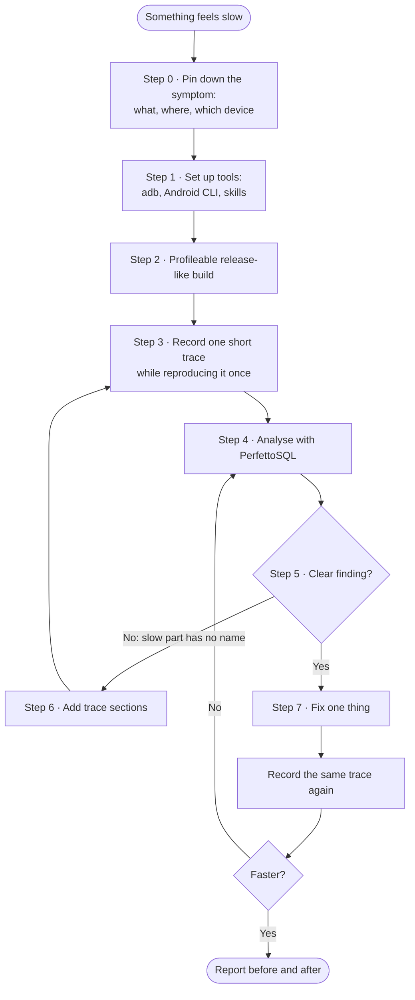
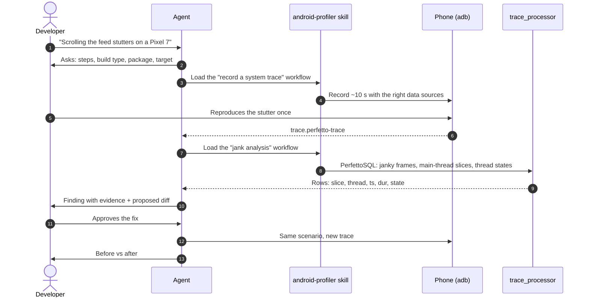
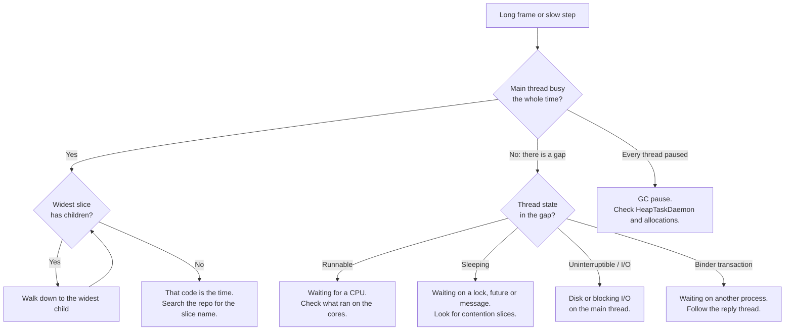

# Android app profiling, end to end — a guide for AI agents

Give this file to your coding agent (Claude Code, Gemini CLI, Codex, Cursor, or any other) and say:

> Read `https://shravz.dev/talks/simplified-performance-debugging/agent-profiling-guide.md` and help me profile my app end to end.

It is written to the agent. A human can follow it too.

From the DevFest Chennai 2026 talk *Simplified Performance Debugging for Native / Cross-Platform Apps Running on Android* by Shangeeth Sivan.
Slides: https://shravz.dev/talks/simplified-performance-debugging/

---

## The whole flow



## How the agent uses the skills

Skills are instructions and scripts an agent loads on demand. With them, the agent does not have to work out how to record a trace, which tables to query or how to write PerfettoSQL. It starts from a known workflow.

| Skill or tool | The agent uses it to | Install |
|---|---|---|
| **android-profiler** (Google, android/skills) | Record system traces, CPU call stacks and heap profiles; analyse jank, ANR, startup, Binder, memory; compare a baseline trace with a new one; write PerfettoSQL | `android skills add android-profiler` |
| **jetpack-compose-performance** (Google) | Find recomposition, stability and lazy-layout problems in Compose code | `android skills add jetpack-compose-performance` |
| **r8-analyzer** (Google) | Check R8 keep rules when the question is app size or optimization | `android skills add r8-analyzer` |
| **Perfetto skill** (Perfetto team) | Query any trace with a bundled `trace_processor`, no separate install | see perfetto.dev/docs/getting-started/using-ai |
| **trace_processor** | Run PerfettoSQL directly when no skill is installed | perfetto.dev/docs/analysis/trace-processor |



**Doing it by hand?** Every step below works without an agent too: record the trace, open it in https://ui.perfetto.dev, and paste the SQL into its *Query (SQL)* tab.

---

## Your role

You are helping a developer find out **where the time went** in their Android app, and fix it. You work from evidence in a trace, not from guesses about the code.

Rules you follow for the whole session:

1. **One question per trace.** Agree on the symptom before recording anything.
2. **Never trust a debuggable build's numbers.** Profile a profileable release-like build.
3. **Show evidence.** Every claim names a slice, a thread, a timestamp and a duration from the trace.
4. **Propose, do not decide.** The developer judges every finding and every fix.
5. **Change one thing, then measure again** with the same scenario on the same device.
6. **Ask before** installing anything on the device, changing build files, or running long commands.
7. **Keep traces local.** They contain package names, thread names and sometimes user data. ui.perfetto.dev opens traces in the browser without uploading them; do not send a trace anywhere else without asking.

---

## Step 0 — Pin down the symptom

Ask the developer, and write the answers down before you continue:

| Ask | Why |
|---|---|
| What feels slow? Scrolling, a screen opening, app startup, a tap that freezes, battery, memory? | Picks the trace type and the data sources. |
| Exact steps to reproduce, and on which screen. | You will record exactly this, once. |
| Device model and Android version. | Cores and refresh rate differ. FrameTimeline needs Android 12+. |
| Framework: Kotlin/Java Views, Jetpack Compose, Flutter, React Native? | Changes where the work shows up (see *Frameworks* below). |
| Package name. | Needed for every query. |
| What would "fixed" look like? | A target, e.g. no frame over the budget, cold start under N ms. |

Useful budgets:

- **Frame budget:** about 16.7 ms at 60 Hz, 11.1 ms at 90 Hz, 8.3 ms at 120 Hz.
- **Jank:** a frame that misses its budget.
- **Frozen frame:** a single frame that takes longer than 700 ms.
- **ANR:** the app does not respond to input for 5 seconds (other timeouts apply to broadcasts and services).

---

## Step 1 — Set up the tools

Check, in this order, and only install what is missing:

```bash
adb devices                      # the phone shows up as "device"
android --version                # Android CLI; install from developer.android.com if missing
android skills add android-profiler            # trace recording + analysis workflows, PerfettoSQL
android skills add jetpack-compose-performance # only for Compose apps
android skills add r8-analyzer                 # only if the question is app size / R8 rules
```

Optional: the Perfetto team's own agent skill bundles `trace_processor`, so you can run PerfettoSQL without a separate install. See https://perfetto.dev/docs/getting-started/using-ai

If no skill is available, use `trace_processor` directly (https://perfetto.dev/docs/analysis/trace-processor) or the Python API (`pip install perfetto`, then `from perfetto.trace_processor import TraceProcessor`).

---

## Step 2 — Build something you can trust

A `debuggable` build turns off much of the compiled-code optimization a release build gets, so its timings mislead. Use a release-like build the tools can still attach to.

**Manifest** (Android 10 / API 29 and newer):

```xml
<application>
    <profileable android:shell="true" />
</application>
```

**A `benchmark` build type** that copies release, signs with the debug key, and stays non-debuggable:

```kotlin
android {
    buildTypes {
        create("benchmark") {
            initWith(getByName("release"))
            signingConfig = signingConfigs.getByName("debug")
            matchingFallbacks += listOf("release")
            isDebuggable = false
        }
    }
}
```

Keep file and line information so stack traces stay readable, and retrace obfuscated names with the R8 mapping file:

```
-keepattributes SourceFile,LineNumberTable
```

Install it: `./gradlew :app:installBenchmark` (the task name follows the build type).

---

## Step 3 — Record one trace

Keep it short (5–15 seconds), reproduce the symptom **once**, and note roughly when it happened.

Pick one way:

**a) On the phone, no laptop.** Settings → Developer options → *System Tracing* → *Record trace* (or add the Quick Settings tile). Reproduce, stop, then pull the file:

```bash
adb pull /data/local/traces/ .
```

**b) From the command line** with Perfetto's helper script:

```bash
curl -O https://raw.githubusercontent.com/google/perfetto/main/tools/record_android_trace
chmod +x record_android_trace
./record_android_trace -o trace.perfetto-trace -t 10s -b 64mb \
  -a com.example.app \
  sched freq idle am wm gfx view binder_driver hal dalvik input res memory
```

`-a` turns on the app's own trace sections (`Trace.beginSection`). It opens the trace in ui.perfetto.dev when it finishes.

**c) Android Studio.** Profiler → *Capture System Activities* (system trace). Add call stack sampling when you also need to see which code is hot.

**d) Startup.** Prefer a Macrobenchmark (see the companion guide, `agentic-perf-workflow.md`). It records a Perfetto trace for every iteration, so you get many startups instead of one.

---

## Step 4 — Analyse the trace

The developer opens the file in https://ui.perfetto.dev. You query it with PerfettoSQL through the android-profiler skill, the Perfetto skill, or `trace_processor`.

Replace `com.example.app` with the real package name. If a table or module name has changed, check the PerfettoSQL docs: https://perfetto.dev/docs/analysis/perfetto-sql-getting-started

**Find the process and its main thread**

```sql
SELECT p.upid, p.pid, p.name, t.utid, t.tid, t.name AS thread
FROM process p JOIN thread t USING (upid)
WHERE p.name = 'com.example.app' AND t.tid = p.pid;
```

**Longest slices on the main thread**

```sql
SELECT s.name, s.ts, s.dur / 1e6 AS dur_ms, s.depth
FROM slice s
JOIN thread_track tt ON s.track_id = tt.id
JOIN thread t USING (utid)
JOIN process p USING (upid)
WHERE p.name = 'com.example.app' AND t.tid = p.pid
ORDER BY s.dur DESC
LIMIT 20;
```

**Where the main thread spent its time** (Running, Runnable, Sleeping, blocked on I/O)

```sql
SELECT ts.state, SUM(ts.dur) / 1e6 AS ms
FROM thread_state ts
JOIN thread t USING (utid)
JOIN process p USING (upid)
WHERE p.name = 'com.example.app' AND t.tid = p.pid
GROUP BY ts.state
ORDER BY ms DESC;
```

**Janky frames** (FrameTimeline, Android 12+)

```sql
SELECT ts, dur / 1e6 AS dur_ms, jank_type, name AS frame
FROM actual_frame_timeline_slice
WHERE upid = (SELECT upid FROM process WHERE name = 'com.example.app')
  AND jank_type != 'None'
ORDER BY dur DESC
LIMIT 20;
```

**App startups**

```sql
INCLUDE PERFETTO MODULE android.startup.startups;
SELECT * FROM android_startups;
```

**Garbage collection and lock contention**

```sql
SELECT s.name, COUNT(*) AS n, SUM(s.dur) / 1e6 AS total_ms
FROM slice s
WHERE s.name GLOB 'GC*' OR s.name GLOB '*contention*'
GROUP BY s.name
ORDER BY total_ms DESC
LIMIT 20;
```

---

## Step 5 — Read what you found

Use this to turn query results into a finding.



| You see | It usually means | Look next |
|---|---|---|
| A wide slice with **no children** on the main thread | That code is the time. | Search the repo for the slice name. |
| A wide slice whose **children** add up to it | The parent is innocent. | Walk down to the widest child. |
| A **gap** on the main thread | Not running. Check the thread state. | `thread_state` for that window. |
| Gap with state **Runnable** | Wanted a CPU and did not get one. | CPU tracks: what else ran, which core. |
| Gap with state **Sleeping** | Waiting on purpose: a lock, a future, a message. | `*contention*` slices, the thread that woke it. |
| Gap with state **Uninterruptible / I/O** | Disk or other blocking I/O. | File or database work on the main thread. |
| A **binder transaction** slice | Waiting on another process. | The server process's reply thread. |
| Gaps on **every** thread at once | Stop-the-world GC pause. | `HeapTaskDaemon`, `GC*` slices, allocation churn. |
| Long work on **RenderThread** | Drawing is heavy (big bitmaps, layers, shadows). | `DrawFrame*` slices and the view hierarchy. |
| `jank_type` names the app | The app missed the deadline. | That frame's main-thread and RenderThread slices. |
| `jank_type` names SurfaceFlinger or the display | The system missed it, not the app. | Usually not the app's code. |

---

## Step 6 — Name the work you cannot see

If the slow part has no useful name in the trace, add one, rebuild the benchmark build, and record again.

```kotlin
import androidx.tracing.trace   // androidx.tracing:tracing-ktx

fun bind(holder: VH, item: Item) = trace("MyAdapter#bind") {
    // ...
}
```

Or the platform API:

```kotlin
Trace.beginSection("MyAdapter#bind")
try { bind(holder, item) } finally { Trace.endSection() }
```

- Name sections `Class#action`, so a search finds them.
- Begin and end on the same thread. Across threads use `Trace.beginAsyncSection(name, cookie)`.
- Names longer than 127 characters throw while tracing is on.
- Do not hide sections behind `BuildConfig.DEBUG`; that removes them from the build you measure.
- For Compose, add `androidx.compose.runtime:runtime-tracing` to see composable names in the trace.

---

## Step 7 — Fix, then prove it

1. Propose the smallest change that removes the slow slice (move work off the main thread, cache, defer, decode smaller, avoid a lock).
2. Show it as a diff. Wait for the developer to agree.
3. Rebuild the same build type, run the same scenario on the same device, record the same trace.
4. Report before and after with the same query. For startup or scrolling, use a Macrobenchmark and compare medians over several runs, not one trace.

---

## Frameworks

All of these run as an Android process, so a system trace shows their threads next to Android's.

- **Kotlin / Java (Views or Compose):** nothing extra. Your `Trace` sections appear on your threads.
- **Flutter:** run in profile mode with timeline events sent to the system trace, then look at the `1.ui` and `1.raster` threads. Check the flag on your Flutter version with `flutter run --help`.

  ```bash
  flutter run --profile --trace-systrace
  ```

- **React Native:** the system trace shows the native side. For the JavaScript, record a Hermes sampling profile in a release build and open it in ui.perfetto.dev, for example with https://github.com/margelo/react-native-release-profiler

---

## What to hand back

End every analysis with this, filled in:

```
Symptom:        <what the developer reported, and the repro steps>
Build:          <build type, profileable yes/no, device, Android version>
Trace:          <file name, duration, when the symptom happens in it>
Finding:        <slice name> on <thread>, <dur> ms at <ts>; thread state <state>
Evidence:       <the query and the rows that show it>
Likely cause:   <one sentence>
Proposed fix:   <one sentence, plus the diff>
How to verify:  <same scenario, same device, which number should change>
Confidence:     <high / medium / low, and why>
```

---

## References

- Perfetto docs — https://perfetto.dev/docs/
- Record a system trace — https://perfetto.dev/docs/getting-started/system-tracing
- PerfettoSQL — https://perfetto.dev/docs/analysis/perfetto-sql-getting-started
- Trace Processor — https://perfetto.dev/docs/analysis/trace-processor
- Perfetto for AI agents — https://perfetto.dev/docs/getting-started/using-ai
- Android system tracing — https://developer.android.com/topic/performance/tracing
- Custom trace events — https://developer.android.com/topic/performance/tracing/custom-events
- Record on the phone — https://developer.android.com/studio/profile/systrace/on-device
- `<profileable>` — https://developer.android.com/guide/topics/manifest/profileable-element
- Android vitals — https://developer.android.com/topic/performance/vitals
- Android skills — https://github.com/android/skills
- Android Performance Analyzer — https://developer.android.com/android-performance-analyzer
