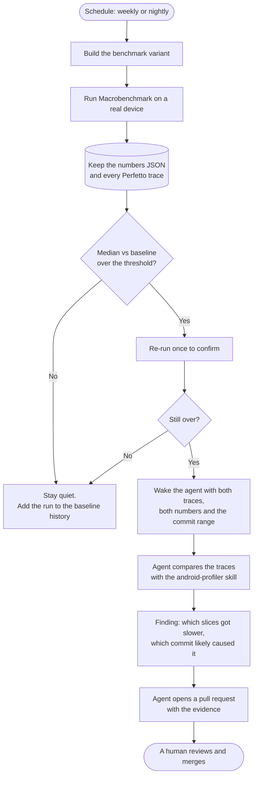
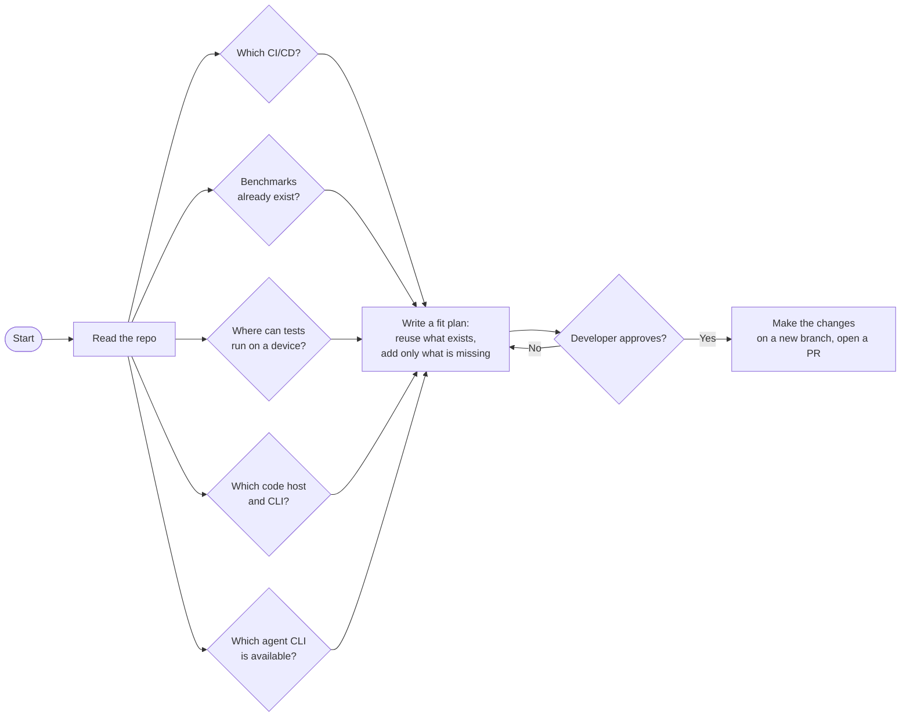
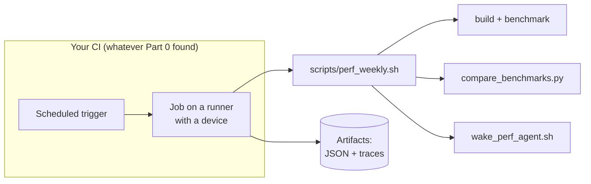
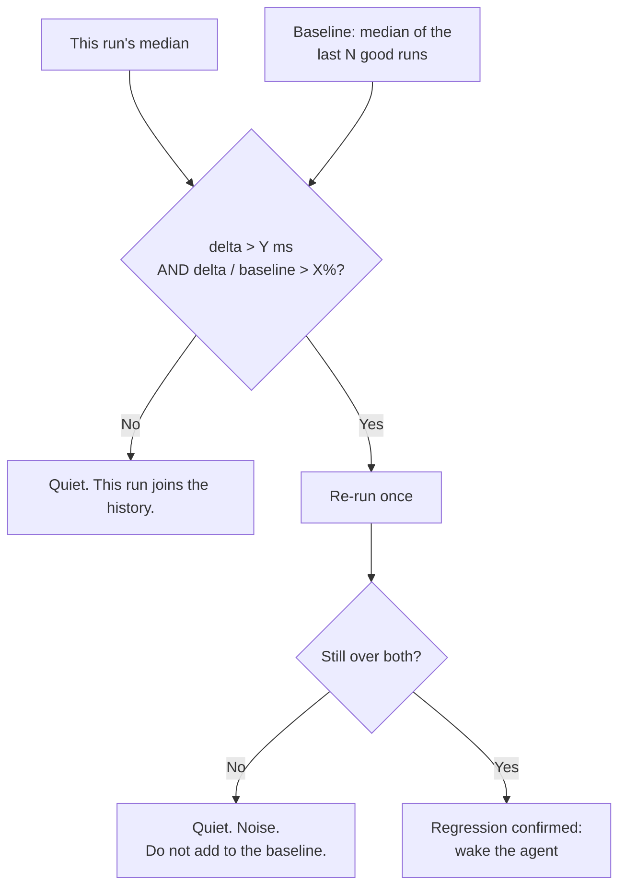
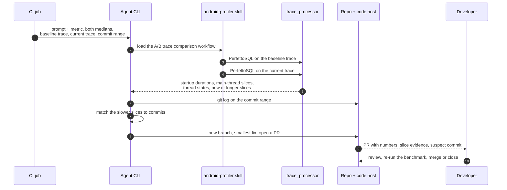

# Agentic performance workflow

**Benchmark every week. When the number crosses a threshold, wake an AI agent on the trace from that run, and let it open a pull request.**

Give this file to your coding agent and say:

> Read `https://shravz.dev/talks/simplified-performance-debugging/agentic-perf-workflow.md`, look at how my project is built and shipped today, and set this up to fit it.

The workflow does not assume a particular CI system, device farm or code host. The agent first **finds out what you already have**, then fits the workflow into it, and asks before it changes anything.

From the DevFest Chennai 2026 talk *Simplified Performance Debugging for Native / Cross-Platform Apps Running on Android* by Shangeeth Sivan. The workflow is a work in progress at Poshmark; this file describes its shape, not a finished product.
Slides: https://shravz.dev/talks/simplified-performance-debugging/ · Companion guide: [agent-profiling-guide.md](agent-profiling-guide.md)

---

## The whole loop



---

## Part 0 — Find out what is already there

This part is for the agent. Do it before writing any file, and report back.



### 0.1 The CI/CD system

Look for these files. More than one can exist; ask which one runs Android builds.

| If you find | It is | Schedules with |
|---|---|---|
| `.github/workflows/*.yml` | GitHub Actions | `on: schedule: - cron:` |
| `.gitlab-ci.yml` | GitLab CI | Pipeline schedules (CI/CD → Schedules), `rules: - if: $CI_PIPELINE_SOURCE == "schedule"` |
| `Jenkinsfile` | Jenkins | `triggers { cron('H 3 * * 1') }` |
| `bitrise.yml` | Bitrise | Scheduled builds in the Bitrise app |
| `.circleci/config.yml` | CircleCI | Scheduled pipelines or `triggers: - schedule:` |
| `.buildkite/pipeline.yml` | Buildkite | Pipeline schedules |
| `azure-pipelines.yml` | Azure Pipelines | `schedules: - cron:` |
| `codemagic.yaml` | Codemagic | Scheduled builds in Codemagic |
| `bitbucket-pipelines.yml` | Bitbucket Pipelines | Pipeline schedules |
| `fastlane/Fastfile` | fastlane lanes, called from any CI | Add a lane; the CI above schedules it |
| `Makefile`, `scripts/*.sh`, `ci/` | Custom scripts | Reuse their entry points |
| Nothing | No CI yet | Propose the smallest job on the code host the repo uses |

Also note: how the app is built today (Gradle tasks, flavors, signing), where artifacts go, how secrets are named, and which runners exist (labels like `self-hosted`, `android`, `device`).

### 0.2 Benchmarks that already exist

Search for:

- a module with `id("com.android.test")` and `targetProjectPath`;
- dependencies on `androidx.benchmark:benchmark-macro-junit4` or `androidx.benchmark:benchmark-junit4`;
- the `androidx.baselineprofile` Gradle plugin, or `BaselineProfileRule`;
- classes using `MacrobenchmarkRule`, `StartupTimingMetric`, `FrameTimingMetric`, `TraceSectionMetric`;
- a `benchmark` (or similar non-debuggable) build type, and `<profileable android:shell="true"/>` in the manifest.

If they exist, **reuse them** and only add what is missing. If not, Part 2 shows how to add them.

### 0.3 Where the benchmark can run

Benchmarks need a **real device** for numbers you can compare.

| Option | Good for | Notes |
|---|---|---|
| A physical phone on a self-hosted runner | The steadiest numbers | Same phone every run. Keep it charged and cool. |
| Firebase Test Lab physical devices | No hardware to manage | Pin one device model and Android version. |
| Another device cloud the team already pays for | Reusing existing contracts | Pin the device. Check it can pull files from the device. |
| An emulator | Checking the job works | Not for numbers: timing on emulators is not representative. |

### 0.4 Code host, storage and the agent

- **Code host and CLI:** GitHub (`gh`), GitLab (`glab`), Bitbucket or Azure DevOps (REST API). This is how the agent opens the PR.
- **Where history lives:** an existing bucket, artifact store, database or metrics system. If there is none, a JSON file on a dedicated branch works.
- **Agent CLI that can run headless:** for example `claude -p`, `gemini -p`, `codex exec`. Use whichever the team already has access to.
- **Skills on the runner:** `android skills add android-profiler`, or the Perfetto skill.

### 0.5 The fit plan

Before changing anything, hand the developer a short plan in this shape:

```
CI/CD:          <found system> → add <one scheduled job / one lane / one stage>
Benchmarks:     <reuse :macrobenchmark / add a new module>, tests: <list>
Device:         <self-hosted phone / Test Lab model + API level>
History:        <where the medians are stored>
Threshold:      <metric>, >X% and >Y ms, confirmed by one re-run
Agent:          <CLI>, skills: <list>, can: create branch + PR only
Files to add:   <paths>
Files to edit:  <paths>
Secrets needed: <names, who creates them>
```

---

## Part 1 — What benchmarking on Android is

A **benchmark** runs the same scenario many times under the same conditions and reports a number you can compare over time. Profiling tells you *why* one run was slow. Benchmarking tells you *whether* things got slower, reliably enough to act on.

| | Macrobenchmark | Microbenchmark |
|---|---|---|
| Measures | Whole user journeys: startup, scrolling, animations, opening a screen | A small piece of code in a loop |
| Runs as | A separate test module that drives your installed app | An instrumented test inside your project |
| Typical metrics | `StartupTimingMetric`, `FrameTimingMetric`, `TraceSectionMetric` | Time per iteration, allocations |
| Traces | Records a Perfetto trace for every iteration | Optional |
| Use it for | Regressions users feel | Hot functions, parsers, algorithms |

This workflow uses **Macrobenchmark**:

- **`StartupTimingMetric`** gives `timeToInitialDisplayMs` (first frame) and `timeToFullDisplayMs` (when the app calls `reportFullyDrawn()`).
- **`FrameTimingMetric`** gives `frameDurationCpuMs` and `frameOverrunMs` while you scroll or animate.
- **`TraceSectionMetric("MyAdapter#bind")`** gives the duration of a section you named with `Trace.beginSection` or `androidx.tracing.trace`.

**Startup modes:** `COLD` (the one users feel most), `WARM`, `HOT`.
**Compilation modes:** `None()`, `Partial()` (with or without a Baseline Profile), `Full()`. Keep it fixed, or numbers move for the wrong reason.

Why it helps performance analysis:

- **Repeatable numbers.** Ten iterations and a median beat one manual trace.
- **Traces for free.** When the number moves, the evidence is already recorded.
- **Regressions caught before users find them**, with the week they arrived.
- **Fixes proven.** The same benchmark shows whether a change actually helped.

A common startup fix the agent may propose is a **Baseline Profile**, which tells ART which code to compile ahead of time.

---

## Part 2 — Add the benchmark (only what is missing)

### 2.1 A build you can measure

```kotlin
// app/build.gradle.kts
android {
    buildTypes {
        create("benchmark") {
            initWith(getByName("release"))
            signingConfig = signingConfigs.getByName("debug")
            matchingFallbacks += listOf("release")
            isDebuggable = false
        }
    }
}
```

```xml
<!-- AndroidManifest.xml -->
<application>
    <profileable android:shell="true" />
</application>
```

### 2.2 The module

Android Studio can create it: *File → New → New Module → Benchmark → Macrobenchmark*. It makes a `com.android.test` module that points at the app with `targetProjectPath = ":app"`.

### 2.3 The tests

```kotlin
@RunWith(AndroidJUnit4::class)
class StartupBenchmark {
    @get:Rule
    val rule = MacrobenchmarkRule()

    @Test
    fun coldStartup() = rule.measureRepeated(
        packageName = "com.example.app",
        metrics = listOf(StartupTimingMetric()),
        iterations = 10,
        startupMode = StartupMode.COLD,
        compilationMode = CompilationMode.Partial(),
    ) {
        pressHome()
        startActivityAndWait()
    }
}

@RunWith(AndroidJUnit4::class)
class FeedScrollBenchmark {
    @get:Rule
    val rule = MacrobenchmarkRule()

    @Test
    fun scrollFeed() = rule.measureRepeated(
        packageName = "com.example.app",
        metrics = listOf(FrameTimingMetric()),
        iterations = 5,
        startupMode = StartupMode.WARM,
        setupBlock = { startActivityAndWait() },
    ) {
        val feed = device.findObject(By.res(packageName, "feed"))
        feed.setGestureMargin(device.displayWidth / 5)
        repeat(3) { feed.fling(Direction.DOWN) }
        device.waitForIdle()
    }
}
```

### 2.4 Run it once by hand

```bash
./gradlew :macrobenchmark:connectedCheck
```

Results land under the module's `build/outputs/connected_android_test_additional_output/` folder:

- `*-benchmarkData.json` with each metric's `minimum`, `median`, `maximum` and per-iteration `runs`;
- `*.perfetto-trace`, one per iteration. These are what the agent reads later.

Check the exact folder on your AGP version after the first run.

---

## Part 3 — One script, any CI

Put the logic in **one script in the repo**. The CI system you found in Part 0 only has to schedule it and keep its artifacts. Switching CI later then means changing a few lines, not the workflow.



```bash
#!/usr/bin/env bash
# scripts/perf_weekly.sh — the whole weekly run. Any CI calls this.
set -euo pipefail

./gradlew :macrobenchmark:connectedCheck

OUT=macrobenchmark/build/outputs/connected_android_test_additional_output
python3 scripts/compare_benchmarks.py --history perf-history/ --current "$OUT" --out result.json

if python3 -c 'import json,sys; sys.exit(0 if json.load(open("result.json"))["regressed"] else 1)'; then
  ./gradlew :macrobenchmark:connectedCheck        # confirm with one re-run
  python3 scripts/compare_benchmarks.py --history perf-history/ --current "$OUT" --out result.json --confirm
  python3 -c 'import json,sys; sys.exit(0 if json.load(open("result.json"))["regressed"] else 1)' \
    && ./scripts/wake_perf_agent.sh result.json
fi
```

How the trigger looks in a few systems (the agent adapts it to the one you have):

```yaml
# GitHub Actions
on:
  schedule: [{ cron: "0 3 * * 1" }]
  workflow_dispatch:
jobs:
  perf:
    runs-on: [self-hosted, android-device]
    steps:
      - uses: actions/checkout@v4
        with: { fetch-depth: 0 }
      - run: ./scripts/perf_weekly.sh
      - uses: actions/upload-artifact@v4
        with: { name: perf, path: macrobenchmark/build/outputs/ }
```

```yaml
# GitLab CI (create a weekly schedule in CI/CD → Schedules)
perf_weekly:
  rules:
    - if: $CI_PIPELINE_SOURCE == "schedule"
  tags: [android-device]
  script: ./scripts/perf_weekly.sh
  artifacts:
    paths: [macrobenchmark/build/outputs/]
```

```groovy
// Jenkinsfile
pipeline {
  agent { label 'android-device' }
  triggers { cron('H 3 * * 1') }
  stages {
    stage('perf') { steps { sh './scripts/perf_weekly.sh' } }
  }
  post { always { archiveArtifacts 'macrobenchmark/build/outputs/**' } }
}
```

Run on the **same physical device every time**, charged, cool, with the same build type, compilation mode and iteration count.

---

## Part 4 — The threshold



1. **Baseline:** the median of the last N good runs (for example 4 weeks), not only last week.
2. **Two conditions:** a relative change **and** an absolute change, for example more than 8% and more than 30 ms on cold-start `timeToInitialDisplayMs`. Tune both to your app.
3. **Confirm with a re-run** before alerting.
4. **Only good runs move the baseline.**
5. **Most weeks should be quiet.**

```python
# scripts/compare_benchmarks.py (core of it)
import json

def median(path, test="coldStartup", metric="timeToInitialDisplayMs"):
    data = json.load(open(path))
    for b in data["benchmarks"]:
        if b["name"] == test:
            return b["metrics"][metric]["median"]
    raise KeyError(test)

def regressed(current_ms, baseline_ms, rel=0.08, abs_ms=30):
    delta = current_ms - baseline_ms
    return delta > abs_ms and delta / baseline_ms > rel
```

---

## Part 5 — Wake the agent

An agent with only a prompt spends its time working out how to read a trace. Give it **context and tools**.



**Inputs the agent gets**

- the metric, the baseline median and this run's median;
- one trace from each run (the iteration closest to its median);
- the commit range: `git log --oneline <baseline_sha>..<current_sha>`;
- [agent-profiling-guide.md](agent-profiling-guide.md) for how to read a trace.

**Tools on the runner**

- `android skills add android-profiler` (it has an A/B baseline comparison workflow and writes PerfettoSQL), or the Perfetto skill, or `trace_processor`;
- the code host CLI (`gh`, `glab`) with a token that can create branches and PRs, nothing more.

**A prompt to start from**

```
Startup regressed. timeToInitialDisplayMs median went from {BASELINE} ms to {CURRENT} ms
(+{DELTA} ms, +{PCT}%) on {DEVICE}, cold start, CompilationMode.Partial.

Traces:
  baseline: {BASELINE_TRACE}
  current:  {CURRENT_TRACE}
Commits in range:
{GIT_LOG}

Using the android-profiler skill and PerfettoSQL:
1. Compare the startup in both traces (android_startups, then main-thread slices
   in the startup window). List slices that got longer or are new, with durations.
2. Compare main-thread state (Running, Runnable, Sleeping, I/O) in both traces.
3. Match the new or longer slices to commits in the range.
4. Propose the smallest fix, on a new branch.
5. Open a pull request. Do not merge.

The PR description must include the two medians, the slices that explain the difference
(name, thread, before ms, after ms), the commit you suspect, and how a reviewer can
verify the fix with the same benchmark.
```

**Starting it headless** — use whichever agent CLI the team has, for example:

```bash
claude -p "$(envsubst < .ci/perf-regression-prompt.md)"
```

---

## Part 6 — Guardrails

- **The agent opens a PR. A human merges.** It never pushes to the main branch.
- **One PR per regression.** If one is open for the same metric, comment on it instead.
- **No evidence, no PR.** Without slice-level evidence, post the analysis on the alert instead.
- **Re-benchmark the PR branch** with the same job, and put the new median in the PR.
- **Least privilege.** The token creates branches and PRs only. No production secrets in the job.
- **Traces stay internal.** They are CI artifacts, not public uploads.
- **Review the threshold monthly.** Many alerts means it is too tight; regressions found by users means it is too loose.

---

## What the agent hands back when setting this up

1. The **fit plan** from Part 0.5, approved by the developer.
2. A branch with: the benchmark build type and module (if missing), `scripts/perf_weekly.sh`, `scripts/compare_benchmarks.py`, `scripts/wake_perf_agent.sh`, the prompt file, and the scheduled job for the CI it found.
3. One manual run's results, showing the JSON and trace paths are right.
4. A pull request with all of the above. A human merges it.

---

## References

- Macrobenchmark overview — https://developer.android.com/topic/performance/benchmarking/macrobenchmark-overview
- Macrobenchmark metrics — https://developer.android.com/topic/performance/benchmarking/macrobenchmark-metrics
- Benchmarking in CI — https://developer.android.com/topic/performance/benchmarking/benchmarking-in-ci
- Baseline Profiles — https://developer.android.com/topic/performance/baselineprofiles/overview
- Android system tracing — https://developer.android.com/topic/performance/tracing
- Perfetto docs — https://perfetto.dev/docs/
- PerfettoSQL — https://perfetto.dev/docs/analysis/perfetto-sql-getting-started
- Perfetto for AI agents — https://perfetto.dev/docs/getting-started/using-ai
- android-profiler skill — https://github.com/android/skills/tree/main/profilers/android-profiler
- Android skills — https://github.com/android/skills
